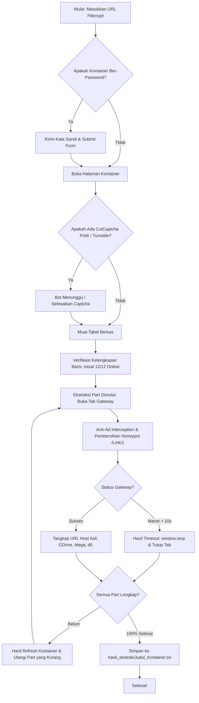

# 🚀 Filecrypt Universal Batch Extractor & Link Resolver

<p align="center">
  
  
  
  
  
  
</p>

**Filecrypt Universal Batch Extractor** adalah alat automasi cerdas berbasis Python dan Playwright untuk mengekstrak seluruh tautan unduhan asli (*Google Drive, FuckingFast, Mega, 1fichier, Datanodes, Qiwi, dll.*) dari kontainer **Filecrypt** (`filecrypt.cc`, `filecrypt.co`, `filecrypt.to`) secara massal.

Alat ini dirancang khusus untuk mengatasi berbagai rintangan proteksi Filecrypt: **CutCaptcha Proof-of-Work (PoW)**, **Cloudflare Turnstile**, **jebakan honeypot anti-bot (`/Link/1`)**, **clickjacking overlay transparan**, **iklan pop-up liar (*about:blank*)**, serta **tab gateway yang macet (*spinning hang*)**.

---

## 📑 Daftar Isi

- [🌟 Fitur Unggulan](#-fitur-unggulan)
- [🔄 Alur Kerja Sistem (Workflow)](#-alur-kerja-sistem-workflow)
- [🛠️ Prasyarat Sistem](#️-prasyarat-sistem)
- [📥 Panduan Instalasi (Langkah Demi Langkah)](#-panduan-instalasi-langkah-demi-langkah)
  - [Opsi A: Instalasi Otomatis (1-Klik untuk Windows)](#opsi-a-instalasi-otomatis-1-klik-untuk-windows)
  - [Opsi B: Instalasi Manual via Terminal / CLI](#opsi-b-instalasi-manual-via-terminal--cli)
- [⚙️ Pengaturan & Konfigurasi (`config_fc.py`)](#️-pengaturan--konfigurasi-config_fcpy)
- [🖥️ Panduan Penggunaan Lengkap](#️-panduan-penggunaan-lengkap)
  - [Mode 1: Antarmuka Grafis Desktop (GUI)](#mode-1-antarmuka-grafis-desktop-gui--direkomendasikan)
  - [Mode 2: Baris Perintah Terminal (CLI / Headless)](#mode-2-baris-perintah-terminal-cli--headless)
- [📂 Format Berkas Output](#-format-berkas-output)
- [⚡ Integrasi dengan Download Manager (JDownloader 2 / IDM)](#-integrasi-dengan-download-manager-jdownloader-2--idm)
- [📁 Struktur Direktori Proyek](#-struktur-direktori-proyek)
- [❓ Pemecahan Masalah (Troubleshooting & FAQ)](#-pemecahan-masalah-troubleshooting--faq)
- [📜 Catatan Etika & Disclaimer](#-catatan-etika--disclaimer)

---

## 🌟 Fitur Unggulan

1. **Bypass CutCaptcha Proof-of-Work (PoW) Otomatis**:
   - Mendeteksi dan menunggu penyelesaian kalkulasi hash kriptografi PoW secara otomatis tanpa butuh intervensi manual.
2. **Network-Level AdBlocker & Anti-Clickjacking**:
   - Memotong request jaringan ke ratusan domain iklan liar (*adsterra, popads, propellerads, exoclick, dsb.*).
   - Menghapus honeypot trap tersembunyi Filecrypt (`/Link/1`) yang sengaja dipasang untuk menjebak bot biasa.
   - Membersihkan elemen overlay transparan tak terlihat yang memicu clickjacking.
   - Menetralkan fungsi `window.open` dan langsung menutup tab kosong (*about:blank*).
3. **Penyelamatan Link Macet (*10-Second Hard Timeout & Auto-Close*)**:
   - Mencegah bot menggantung ketika server gateway Filecrypt mengalami lag/stuck. Jika tab gateway berputar lebih dari 10 detik, bot akan mengeksekusi `window.stop()` dan menutup tab secara instan.
4. **Sistem Pemulihan & Multi-Pass Auto-Retry**:
   - Part yang belum sempat terurai pada putaran pertama akan otomatis diulang.
   - Bot melakukan *Hard Refresh* pada kontainer utama untuk memperbarui token sesi gateway yang kedaluwarsa hingga seluruh part selesai 100%.
5. **Auto Force-Refresh Tabel Berkas**:
   - Membaca header kontainer (*contoh: `12/12 Online`*). Jika baris tombol belum ter-render lengkap oleh JavaScript Filecrypt, bot akan merefresh tabel secara otomatis sebelum proses ekstraksi dimulai.
6. **Penamaan Berkas Otomatis Sesuai Judul Asli**:
   - Berkas hasil langsung dinamai sesuai judul game/konten kontainer (*contoh: `Hitman 3 Deluxe Edition MULTi9-ElAmigos.txt`*), bukan nama generic acak.
7. **Dukungan Kontainer Ber-Password**:
   - Tersedia kolom kata sandi baik pada antarmuka GUI maupun argumen CLI.
8. **Dua Mode Operasional Fleksibel**:
   - **Mode GUI Desktop (Tkinter)**: Dilengkapi jam aktif, pemantau waktu berlalu (*elapsed time*), log realtime bertimestamp, dan tombol satu klik untuk salin link serta buka folder.
   - **Mode CLI / Terminal**: Ringan, cepat, dan siap diintegrasikan ke script automasi server.

---

## 🔄 Alur Kerja Sistem (Workflow)



---

## 🛠️ Prasyarat Sistem

Sebelum menjalankan aplikasi, pastikan sistem Anda memenuhi spesifikasi berikut:

- **Sistem Operasi**: Windows 10/11, Linux (Ubuntu/Debian/Arch), atau macOS.
- **Python**: Versi **3.10** ke atas (direkomendasikan Python 3.11 atau 3.12).
- **Git**: Terpasang untuk melakukan clone dan update repository.
- **Koneksi Internet**: Stabil untuk memuat halaman Filecrypt dan mengunduh browser driver Chromium Playwright.

---

## 📥 Panduan Instalasi (Langkah Demi Langkah)

### Opsi A: Instalasi Otomatis (1-Klik untuk Windows)

Jika Anda menggunakan Windows, seluruh proses instalasi dependensi sudah disederhanakan:

1. **Clone Repository ini**:
   ```powershell
   git clone https://github.com/studentawangihti/Filecrypt-Pass-Automated.git
   cd Filecrypt-Pass-Automated
   ```
2. **Jalankan Installer Dependensi**:
   - Klik dua kali berkas **`Install_Dependensi.bat`**, ATAU
   - Jalankan lewat terminal:
     ```powershell
     .\Install_Dependensi.bat
     ```
   Skrip ini akan secara otomatis:
   - Memasang seluruh modul Python dari `requirements.txt` (`playwright`, `requests`).
   - Mengunduh browser driver **Chromium Playwright**.

---

### Opsi B: Instalasi Manual via Terminal / CLI

Jika Anda ingin mengatur instalasi secara manual atau menggunakan Linux / macOS:

1. **Buka Terminal / Command Prompt** dan masuk ke folder proyek:
   ```bash
   git clone https://github.com/studentawangihti/Filecrypt-Pass-Automated.git
   cd Filecrypt-Pass-Automated
   ```

2. *(Opsional tapi Disarankan)* **Buat & Aktifkan Virtual Environment**:
   ```bash
   # Windows:
   python -m venv venv
   .\venv\Scripts\activate

   # Linux / macOS:
   python3 -m venv venv
   source venv/bin/activate
   ```

3. **Install Dependensi Python**:
   ```bash
   pip install -r requirements.txt
   ```

4. **Install Browser Chromium untuk Playwright**:
   ```bash
   playwright install chromium
   ```

---

## ⚙️ Pengaturan & Konfigurasi (`config_fc.py`)

Seluruh preferensi operasional dikelola di berkas [`config_fc.py`](file:///c:/laragon/www/Filecrypt%20Pass/config_fc.py). Pengaturan default sudah disesuaikan agar langsung berfungsi out-of-the-box tanpa konfigurasi manual:

| Parameter | Default | Keterangan |
| :--- | :--- | :--- |
| `CHROME_EXECUTABLE_PATH` | *Auto-detected* | Mendeteksi Chromium Playwright di `LOCALAPPDATA/ms-playwright` atau fallback ke Chrome sistem. |
| `USER_DATA_DIR` | *Auto-detected* | Folder profil browser. Menggunakan `Chrome for Testing` jika tersedia, atau membuat `fc_chrome_profile` lokal. |
| `OUTPUT_DIR` | `hasil_ekstrak/` | Folder direktori penyimpanan berkas teks hasil ekstraksi link. |
| `DEFAULT_BATCH_INPUT`| `fc_containers.txt` | Berkas teks default untuk memuat daftar URL kontainer massal. |
| `FILECRYPT_DOMAINS` | `filecrypt.cc`, `.co`, `.to` | Domain resmi Filecrypt yang diizinkan untuk navigasi bot. |
| `AD_BLACKLIST_KEYWORDS` | *Array 30+ kata kunci* | Daftar filter domain iklan (pop-up, redirect, banner clickjacking). |
| `SELECTORS` | *Dictionary CSS Selector* | Pemetaan selector elemen DOM HTML untuk form captcha, password, tabel, dan tombol unduh. |

> [!TIP]
> Anda tidak perlu mengubah berkas konfigurasi ini kecuali jika Anda ingin menyesuaikan direktori output khusus atau menambahkan domain iklan tertentu ke dalam blacklist.

---

## 🖥️ Panduan Penggunaan Lengkap

### Mode 1: Antarmuka Grafis Desktop (GUI) — *Direkomendasikan*

Mode ini sangat nyaman untuk penggunaan harian dengan pemantauan visual realtime.

1. **Jalankan GUI**:
   - Klik dua kali berkas **`Jalankan_GUI.bat`**, ATAU
   - Jalankan perintah berikut di terminal:
     ```powershell
     python gui_filecrypt.py
     ```

2. **Langkah Penggunaan di GUI**:
   - **Input Tautan**: Paste satu atau beberapa URL kontainer Filecrypt di kotak teks input (satu link per baris).
     *Contoh:*
     ```text
     https://www.filecrypt.cc/Container/B6A25839DC.html
     https://www.filecrypt.cc/Container/14AA145468.html
     ```
   - **Fitur Muat File**:
     - Klik **📁 Buka File .txt Luar** untuk memilih berkas teks dari komputer Anda.
     - Klik **📄 Muat 'fc_containers.txt' Default** untuk mengambil daftar URL dari berkas `fc_containers.txt`.
   - **Password (Opsional)**: Masukkan kata sandi pada kolom password jika kontainer diproteksi.
   - **Mulai Ekstraksi**: Klik tombol **🚀 Mulai Ekstrak Batch**.
   - **Pemantauan**: Jendela browser akan terbuka secara otomatis. Anda dapat memantau log aktivitas, jumlah part yang berhasil diambil, dan total waktu proses secara langsung.
   - **Akses Hasil**:
     - Klik tombol **📋 Salin Link Hasil** untuk menyalin daftar URL bersih ke clipboard.
     - Klik tombol **📂 Buka Folder Hasil** untuk langsung membuka folder `hasil_ekstrak/` di Windows Explorer.
   - **Pembatalan**: Klik tombol **🛑 Hentikan** jika ingin membatalkan antrean sewaktu-waktu dengan aman.

---

### Mode 2: Baris Perintah Terminal (CLI / Headless)

Mode ini ideal untuk automasi terjadwal, script pipeline, atau penggunaan di server tanpa tampilan antarmuka:

```powershell
# Sintaks Dasar:
python extractor_engine.py <URL_FILECRYPT> [PASSWORD_OPSIONAL]
```

#### Contoh Perintah:

1. **Ekstraksi Kontainer Tanpa Password**:
   ```powershell
   python extractor_engine.py https://www.filecrypt.cc/Container/B6A25839DC.html
   ```

2. **Ekstraksi Kontainer dengan Password**:
   ```powershell
   python extractor_engine.py https://www.filecrypt.cc/Container/75E841B5DD.html rahasia123
   ```

3. **Ekstraksi Massal via PowerShell Loop**:
   ```powershell
   Get-Content fc_containers.txt | ForEach-Object { python extractor_engine.py $_ }
   ```

---

## 📂 Format Berkas Output

Setiap kontainer yang selesai diekstrak akan otomatis disimpan ke dalam direktori `hasil_ekstrak/` dengan format nama berkas:
`hasil_ekstrak/<Judul_Kontainer>.txt`

### Contoh Isi Berkas (`Hitman 3 Deluxe Edition MULTi9-ElAmigos.txt`):

```text
# Filecrypt Kontainer: https://www.filecrypt.cc/Container/B6A25839DC.html
# Judul: Hitman 3 Deluxe Edition MULTi9-ElAmigos
# Total Part di Kontainer: 12
# Berhasil Diekstrak: 12
=================================================================

[DETAIL STATUS PART DAN LINK]
OG12088-H3DEM9E.part01.rar [4.95 GB] -> https://drive.google.com/file/d/1WbDCHcRCfunhKth_D_9fsOJV0YP_NrL3/view?usp=sharing
OG12088-H3DEM9E.part02.rar [4.95 GB] -> https://drive.google.com/file/d/1WfjgIC2xrinJIg8q16guF5WhoyJt78Uf/view?usp=sharing
OG12088-H3DEM9E.part03.rar [4.95 GB] -> https://drive.google.com/file/d/1XJ2HvfjEnPLnk6EJPbgUAmjaP2p55YOx/view?usp=sharing
...
OG12088-H3DEM9E.part12.rar [2.35 GB] -> https://drive.google.com/file/d/1cv1L3Ll5OBRC9_57hwjVdkpD7cLkZKwj/view?usp=sharing

[DAFTAR LINK BERSIH]
https://drive.google.com/file/d/1WbDCHcRCfunhKth_D_9fsOJV0YP_NrL3/view?usp=sharing
https://drive.google.com/file/d/1WfjgIC2xrinJIg8q16guF5WhoyJt78Uf/view?usp=sharing
https://drive.google.com/file/d/1XJ2HvfjEnPLnk6EJPbgUAmjaP2p55YOx/view?usp=sharing
...
https://drive.google.com/file/d/1cv1L3Ll5OBRC9_57hwjVdkpD7cLkZKwj/view?usp=sharing
```

- **Bagian 1 (`DETAIL STATUS PART DAN LINK`)**: Sangat berguna untuk memverifikasi nama file part, nomor urutan, serta ukuran file (*size*) dari masing-masing part.
- **Bagian 2 (`DAFTAR LINK BERSIH`)**: Berisi link murni baris-demi-baris tanpa teks tambahan, siap di-copy langsung ke aplikasi pengunduh.

---

## ⚡ Integrasi dengan Download Manager (JDownloader 2 / IDM)

Berkas hasil ekstraksi dirancang agar langsung kompatibel dengan download manager terpopuler:

### 1. JDownloader 2
1. Buka berkas `.txt` di `hasil_ekstrak/` lalu salin seluruh bagian **`[DAFTAR LINK BERSIH]`** (atau cukup copy semua isi teks).
2. **JDownloader 2** dengan fitur *Clipboard Observer* aktif akan otomatis mendeteksi link dan memasukkannya ke tab **LinkGrabber**.
3. Klik **Start All Downloads**.

### 2. Internet Download Manager (IDM)
1. Buka IDM -> Menu **Tasks** -> **Add batch download from clipboard** (atau **Import** -> **From text file**).
2. Pilih berkas `.txt` hasil ekstraksi.
3. Centang semua part file lalu klik **OK** untuk mulai mengunduh secara paralel.

---

## 📁 Struktur Direktori Proyek

```text
Filecrypt-Pass-Automated/
├── .gitignore               # Konfigurasi pengecualian file git (cache, profile, media)
├── Install_Dependensi.bat   # Skrip instalasi 1-klik modul Python & Playwright
├── Jalankan_GUI.bat         # Skrip peluncur 1-klik GUI desktop
├── README.md                # Dokumentasi lengkap proyek
├── config_fc.py             # Konfigurasi sistem, jalur browser, selector & blacklist iklan
├── extractor_engine.py      # Mesin inti Playwright async resolver & ad blocker
├── fc_containers.txt        # Berkas teks daftar link batch default
├── gui_filecrypt.py         # Antarmuka desktop Tkinter dengan multithreading
├── requirements.txt         # Daftar pustaka Python yang dibutuhkan
└── hasil_ekstrak/           # Folder penyimpanan hasil ekstraksi (.txt)
    ├── Bloodborne Game of the Year Edition Recompiled MULTi14-ElAmigos.txt
    ├── Clair Obscur Expedition 33 Deluxe Edition MULTi12-ElAmigos.txt
    ├── Hitman 3 Deluxe Edition MULTi9-ElAmigos.txt
    └── Red Dead Redemption 2 MULTi13-ElAmigos.txt
```

---

## ❓ Pemecahan Masalah (Troubleshooting & FAQ)

### Q: Muncul pesan error `playwright._impl._errors.Error: Executable doesn't exist`?
> **Solusi**: Browser driver Chromium belum diunduh oleh Playwright. Jalankan perintah:
> ```powershell
> playwright install chromium
> ```
> Atau klik dua kali berkas **`Install_Dependensi.bat`**.

### Q: Browser terbuka tetapi tab gateway macet (*spinning* terus-menerus)?
> **Solusi**: Hal ini wajar terjadi saat server Filecrypt sedang padat. Bot sudah dilengkapi proteksi **10-Second Hard Timeout**. Biarkan bot bekerja: tab yang macet akan otomatis dihentikan dan ditutup pada detik ke-10, lalu diulang kembali secara otomatis melalui sistem *Hard Refresh*.

### Q: Apakah saya boleh mengklik browser yang sedang berjalan?
> **Solusi**: Disarankan untuk **tidak mengklik atau menutup jendela browser secara manual** agar bot tidak kehilangan fokus konteks halaman. Namun, jika muncul tantangan captcha interaktif visual (seperti puzzle gambar Cloudflare Turnstile yang jarang muncul), Anda dapat menyelesaikannya sekali langsung di layar browser.

### Q: Server Filecrypt memunculkan pesan "Rate limit exceeded" / "Access Denied"?
> **Solusi**: Jika Anda mengekstrak ratusan link dalam waktu singkat, Filecrypt dapat membatasi IP Anda sementara. Beri jeda 5–10 menit, atau gunakan VPN / restart modem internet untuk memperbarui alamat IP Anda.

---

## 📜 Catatan Etika & Disclaimer

Proyek ini dikembangkan semata-mata untuk tujuan edukasi, riset otomasi browser, dan membantu pengguna mengelola unduhan berkas secara sah dan efisien. Penulis tidak berafiliasi dengan Filecrypt maupun penyedia layanan penyimpanan pihak ketiga manapun. Pengguna bertanggung jawab penuh atas penggunaan alat ini sesuai dengan hukum dan ketentuan layanan yang berlaku di masing-masing platform.
